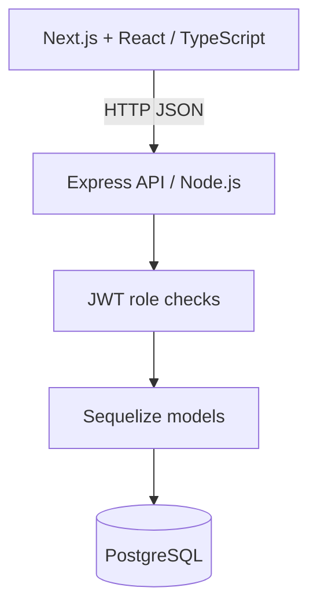

# SkillBridge SA

**Youth employment and work-readiness hackathon starter** — adapted from the architectural approach of PavelPayments (Next.js, Express, PostgreSQL). This is a **separate application**: payment, NFC and gym-specific code has deliberately been omitted.

## Contents
- [What works](#what-works)
- [Architecture](#architecture)
- [Run locally](#run-locally)
- [Demo walkthrough](#demo-walkthrough)
- [API routes](#api-routes)
- [Limitations and next steps](#limitations-and-next-steps)

## What works
- Demo account login with bcrypt-hashed passwords and JWTs
- Three roles: SEEKER, EMPLOYER, ADMIN
- Employer creates an opportunity (starts PENDING)
- Admin approves/rejects an opportunity
- Job seeker browses approved opportunities and applies
- Employer shortlists/accepts/declines applications
- Job seeker views updated application status
- Skills-overlap ranking with an explainable score (not AI)
- Persistent PostgreSQL data via Sequelize

## Architecture

## Run locally
Requirements: Node.js 20+, npm, Docker Desktop or PostgreSQL 16.

1. `docker compose up -d` (or configure your own PostgreSQL instance).
2. Copy `.env.example` values into `apps/core-backend/.env`. Change `JWT_SECRET` to a secure random string.
3. `cd apps/core-backend && npm install && npm run dev`
4. In another terminal: `cd apps/web-client && npm install && npm run dev`
5. Visit `http://localhost:3000`.

The database schema is created on startup. `SEED_DEMO=true` creates three demo users and two **fictional** opportunities on an empty database. Default demo password is `ChangeMe123!` unless overridden by `DEMO_PASSWORD` before the first seed. **Change or disable these credentials before public deployment.**

## Demo walkthrough
1. Sign in as **Employer** (`employer@skillbridge.local`) and post a micro-internship.
2. Sign in as **Admin** (`admin@skillbridge.local`) and approve the new listing.
3. Sign in as **Job Seeker** (`seeker@skillbridge.local`), see the opportunity, inspect skill matches and apply.
4. Return to Employer and shortlist the application.
5. Return to Job Seeker and observe the updated status.

## API routes
| Method | Path | Role |
|---|---|---|
| POST | `/api/auth/login` | Public |
| GET | `/api/jobs` | Authenticated; role-filtered |
| POST | `/api/jobs` | Employer |
| PATCH | `/api/jobs/:id/verify` | Admin |
| POST | `/api/jobs/:id/apply` | Job Seeker |
| GET | `/api/applications` | Authenticated; role-filtered |
| PATCH | `/api/applications/:id` | Employer who owns the opportunity |
| GET | `/api/matches` | Job Seeker |

## Limitations and next steps
- This is a **first runnable scaffold**, not a verified production deployment. Dependency installation, build and end-to-end tests have **not yet been executed** in this environment.
- No public registration, password recovery, employer identity verification, CV upload, real vacancy feeds or email alerts yet.
- Skills matching is simple case-insensitive comma-separated overlap; it does not constitute AI or verified skill assessment.
- Demo accounts and seeded vacancies are for demonstration only. Never present fictional opportunities as genuine vacancies.
- Before hosting: implement signup, rate limiting, security headers, CSRF strategy appropriate to token storage, stronger validation, controlled DB migrations, secure HTTPS and secrets, and proper automated tests.
- The user/team must confirm they have permission to reuse jointly owned PavelPayments project elements.
