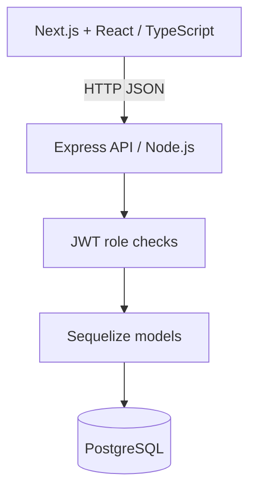

# SkillBridge SA

**Connecting South African youth with employment opportunities.**

SkillBridge SA is a youth employment and work-readiness platform developed by Team Hexcode. It connects job seekers with employers through job listings, digital profiles, applications, and skills-based matching.

**Live website:** https://skillbridge-web-o9ma.onrender.com

## Contents
- [Key Features](#key-features)
- [Architecture](#architecture)
- [Run locally](#run-locally)
- [Demo walkthrough](#demo-walkthrough)
- [API Endpoints](#api-endpoints)
- [Limitations and next steps](#limitations-and-next-steps)
- [Development Team](#development-team)

## Key Features

### Job Seekers
- Register and sign in.
- Create and update profiles.
- Upload profile pictures and certificates.
- Search and browse job opportunities.
- View explainable skills-based matching scores.
- Apply for opportunities and withdraw applications.
- Track application statuses.

### Employers
- Register and sign in.
- Create and manage job opportunities.
- Close job opportunities.
- Review applicant profiles and supporting documents.
- Compare applicants using skills-based scores.
- Shortlist, accept, or decline applications.

### Security and Notifications
- bcrypt password hashing.
- JWT authentication and role-based authorization.
- Password-reset links with 30-minute expiry.
- Single-use password-reset tokens.
- Rate limiting for password-reset requests.
- Session invalidation following password changes.
- Application-status emails using Resend when configured.
- File uploads using Cloudinary.

### Technology Stack

| Layer | Technology |
|---|---|
| Frontend | Next.js, React, TypeScript |
| Backend | Node.js, Express |
| Database | PostgreSQL |
| ORM | Sequelize |
| Authentication | JWT, bcrypt |
| Email | Resend |
| File Storage | Cloudinary |
| Hosting | Render |

## Architecture

## Run Locally

Requirements: Node.js 20+, npm, PostgreSQL and Git.

1. Clone the repository:
   `git clone https://github.com/mpinizonke-blip/SkillBridge.git`
2. Configure PostgreSQL and create `apps/core-backend/.env` using `.env.example` where available.
3. Set `PORT=4001`, `FRONTEND_URL=http://localhost:3002`, database credentials and a secure `JWT_SECRET`.
4. Start the backend:
   `cd apps/core-backend && npm install && npm start`
5. From the repository root, start the frontend:
   `cd apps/web-client && npm install && npm run dev -- -p 3002`
6. Open `http://localhost:3002`.

Email notifications and password recovery require configured Resend credentials and an authorized sender. Never commit `.env` files.

## Demo Walkthrough

1. Register and sign in as a Job Seeker.
2. Complete your profile and add skills and certificates.
3. Browse jobs, view matching scores and apply.
4. Sign in as an Employer and create an opportunity.
5. Review applicants and shortlist, accept or decline applications.
6. Return to the Job Seeker account to check application status.
7. Show the About Us, Help Centre and Forgot Password pages.

## API Endpoints

The SkillBridge SA backend provides REST API endpoints for authentication, job opportunities, applications, and skills matching.

### Authentication

| Method | Endpoint | Description |
|---|---|---|
| POST | `/api/auth/login` | Sign in and receive a JWT |
| POST | `/api/auth/forgot-password` | Request a password-reset link |
| POST | `/api/auth/reset-password` | Set a new password using a valid reset token |

### Job Opportunities

| Method | Endpoint | Description |
|---|---|---|
| GET | `/api/jobs` | Retrieve job opportunities |
| POST | `/api/jobs` | Create a job opportunity |
| PATCH | `/api/jobs/:id/verify` | Approve or reject a job |
| POST | `/api/jobs/:id/apply` | Apply for a job |

### Applications

| Method | Endpoint | Description |
|---|---|---|
| GET | `/api/applications` | Retrieve applications |
| PATCH | `/api/applications/:id` | Update application status |

### Job Matching

| Method | Endpoint | Description |
|---|---|---|
| GET | `/api/matches` | Retrieve skills-based job matches |

### Authentication Header

Protected endpoints require:

`Authorization: Bearer YOUR_JWT_TOKEN`

## Limitations and next steps

- Password-reset and application-status emails require valid Resend credentials and an authorized sender.
- Skills matching is rule-based rather than AI-powered.
- Employer identity verification can be strengthened.
- The application requires additional automated end-to-end and security testing.
- Production deployments require correctly configured environment variables, HTTPS, and database connectivity.
- Demo opportunities must not be presented as genuine vacancies.

## Development Team

**Team Hexcode**

- Zonke Mpini
- Yamkelani Gqokoma
- Siphamandla Klaas
- Thembalethu Sambo
- Inam Khwetana

## GitHub Repository

https://github.com/mpinizonke-blip/SkillBridge